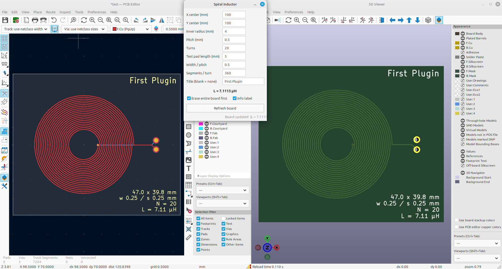
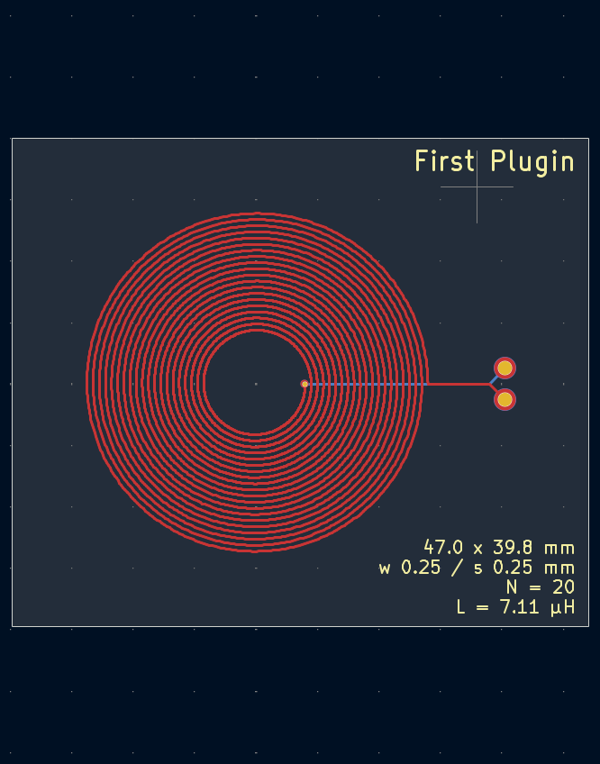
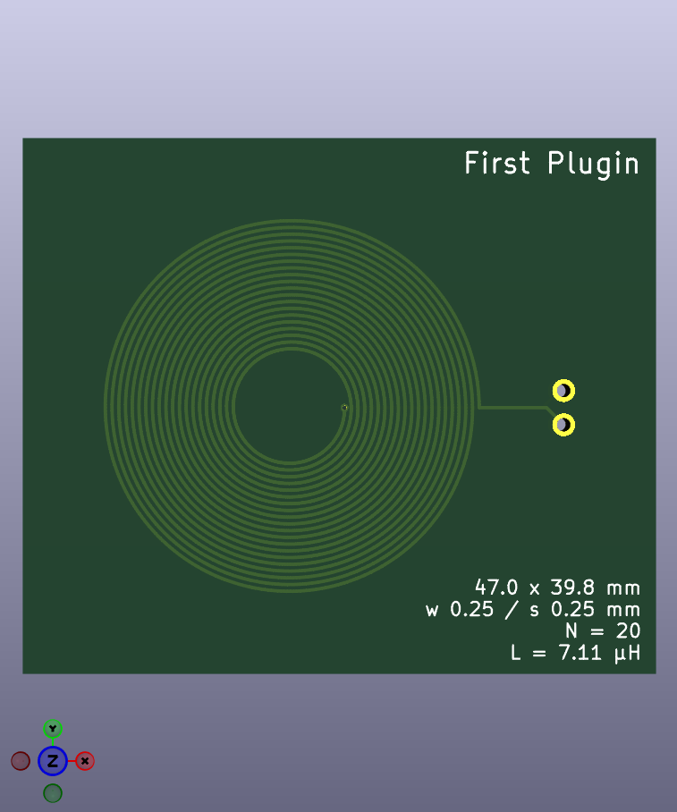

# Spiral Inductor Generator for KiCad

A KiCad plugin that turns six numbers into a complete planar spiral-inductor board: traces,
return path, probe-ready test pads, board outline and silkscreen label. It estimates the
inductance live as you type, before a single track is placed.



<p align="center">
  
  
</p>

## Why

Printed spiral coils are the antennas and inductors behind NFC tags, wireless power and
resonant circuits. Drawing one by hand means placing thousands of track segments, and
changing the turn count or pitch means starting over. This plugin builds the whole thing from
its parameters, so a new variant takes seconds, and the L readout shows what each change does
to the inductance before it goes on a board.

## Features

- **Generates the spiral** on F.Cu as an Archimedean curve in 360 short segments per turn
  (about 7,200 tracks for the default coil), with a center via and a B.Cu return trace
- **Two test-pad vias** sized for a single Dupont / 0.1" header pin each: 1.0 mm drill, 1.7 mm
  pad, 2.54 mm apart, solder mask opened on both sides
- **Board outline** on Edge.Cuts, 6 mm outside all copper, computed from the actual geometry
- **Silkscreen label** (board size, trace and gap, turns, L) and an optional title
- **Live inductance estimate** from the Mohan current-sheet formula, with a short-circuit
  warning when the trace is as wide as the pitch
- **One click in the PCB Editor.** It runs as a KiCad IPC plugin with a wxPython window, so
  there is no Python setup for the user

> [!WARNING]
> **"Erase entire board first" deletes everything on the open board**, not only the spiral.
> Use the plugin on a new, empty board. Ctrl+Z undoes it: each Refresh is two undo steps.

## Install

1. Download `spiral_coil.zip` from the [Releases](../../releases) page and unzip it.
2. Copy the `spiral_coil` folder into KiCad's `plugins` folder (not `scripting/plugins`):

   | OS | Folder |
   |---|---|
   | Windows | `Documents\KiCad\<version>\plugins\` |
   | macOS | `~/Documents/KiCad/<version>/plugins/` |
   | Linux | `~/.local/share/kicad/<version>/plugins/` |

3. In KiCad: **Preferences → Preferences… → Plugins** → check **Enable KiCad API**.
4. Quit and restart KiCad, open a board, and click the spiral icon on the PCB Editor toolbar.

Needs KiCad 9 or newer, and internet on the first click (KiCad fetches the plugin's
dependencies into a private environment). Full instructions and troubleshooting are in
[`spiral_coil/README.md`](spiral_coil/README.md).

## Design starting points

Air-core coils on 1 oz copper, trace width = half the pitch unless noted.

| Use | Inner radius | Pitch | Turns | W | L | Outer diameter |
|---|---|---|---|---|---|---|
| Default test coil | 4 mm | 0.5 mm | 20 | 0.5 | 7.11 µH | 28 mm |
| NFC tag, 13.56 MHz with a 50 pF chip | 14 mm | 1.0 mm | 7 | 0.5 | 2.79 µH | 42.5 mm |
| Qi transmitter (A11-style footprint) | 10.25 mm | 1.2 mm | 10 | 0.75 | 3.98 µH | 45.4 mm |
| Qi receiver | 6 mm | 0.8 mm | 18 | 0.75 | 8.48 µH | 41.4 mm |

For NFC, resonance with a chip capacitance C needs L = 1 / ((2π · 13.56 MHz)² · C), which is
about 2.76 µH for 50 pF. The Qi rows match the footprints but not the performance: a PCB trace
carries far less copper than the litz wire in a commercial coil, and the Q comes out around 4.5
at 100 kHz on 1 oz copper against 90 or more for a commercial part. They suit measuring
coupling and lighting LEDs, not charging a phone.

## The math

The spiral is a curve in polar coordinates, `r(θ) = r_in + (p / 2π) · θ` for `θ` from 0 to
`2πn`, where `p` is the pitch and `n` the number of turns. The plugin samples it into straight
track segments and converts each point to x and y.

**Trace length.** The arc length of that curve is the total length of copper. With
`b = p / 2π` and `u = r / b`:

```
s = (b / 2) · [ u·√(1 + u²) + asinh(u) ]      evaluated from u = r_in/b to (r_in + p·n)/b
```

For the default coil this gives 1131.02 mm. The 360-segment polyline the plugin draws comes
out at 1131.01 mm, so the straight-segment approximation costs about 0.001% in length. At
0.25 mm wide on 1 oz copper that length is roughly 2.2 Ω of DC resistance (a back-of-envelope
figure; the plugin does not calculate it).

**Inductance.** The estimate uses the current-sheet formula from Mohan et al.:

```
L = (μ₀ · n² · d_avg · c₁ / 2) · ( ln(c₂ / ρ) + c₃·ρ + c₄·ρ² )

d_avg = (d_out + d_in) / 2        ρ = (d_out − d_in) / (d_out + d_in)
```

The formula assumes evenly spaced turns. A spiral drifts outward continuously, so `d_in` and
`d_out` are taken at the average radius of the innermost and outermost turn:

```
d_in  = 2·(r_in + p/2)       − w
d_out = 2·(r_in + p·(n − ½)) + w
```

## Status and limits

- **Works end to end in KiCad 10.0 on Linux Mint.** Windows and macOS follow KiCad's
  documented plugin locations but haven't been tested.
- **The inductance is an estimate, not a measurement.** I haven't yet compared it with a
  fabricated board. Expect a few percent to perhaps 10% from the real coil, plus stray
  capacitance from the test pads and whatever is connected to them.
- **Air core only.** A ferrite sheet behind the coil raises L.
- **Resistance isn't modelled.** For power coils, DC resistance limits Q more than L does.
- **Check your fab's minimum trace and space.** At small pitches the trace and gap can fall
  below what a low-cost fab can make (roughly 0.15 mm).

## Repository layout

| Path | What it is |
|---|---|
| [`spiral_coil/`](spiral_coil/) | The plugin: `plugin.json`, the wxPython window, geometry builder, and `mohan.py` |
| `Kicad_Python_Test.py`, `MultiTrace.py` | Early experiments with the KiCad IPC API that led to the plugin |
| [`docs/`](docs/) | Project notes |

The generator also runs from a terminal with KiCad open and the API enabled:

```bash
pip install kicad-python numpy
python spiral_coil/spiral.py
```

## Credits

- S. S. Mohan, M. del Mar Hershenson, S. P. Boyd and T. H. Lee, "Simple accurate expressions
  for planar spiral inductances," *IEEE Journal of Solid-State Circuits*, vol. 34, no. 10,
  pp. 1419–1424, Oct. 1999.
- [kicad-python](https://gitlab.com/kicad/code/kicad-python), the official Python bindings for
  KiCad's IPC API.
- Built by Reid ([reidssommers-design](https://github.com/reidssommers-design)). It began as a
  polar-coordinates project for BYU-Idaho MATH 215; those notes are in
  [`docs/MATH215-SDL3.md`](docs/MATH215-SDL3.md).